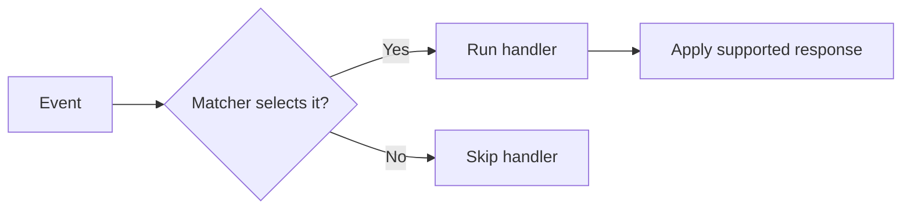
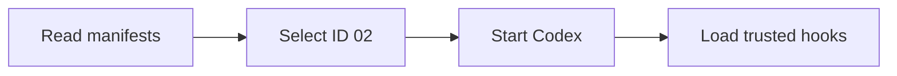

# Codex CLI hooks

<p class="lead">Run code at defined points in the agent lifecycle</p>

Add runtime context · Check tool calls · Observe execution

**Events, matchers, handlers, and response contracts**

<!--
Hooks are runtime callbacks, distinct from instructions that ask the model to remember a workflow. Source: https://learn.chatgpt.com/docs/hooks
-->

---
class: compact
---

# Event, matcher, and handler



- **Event:** selects the lifecycle point
- **Matcher:** filters one event field
- **Handler:** runs code and inspects the payload
- **Response:** provides context, a decision, feedback, or diagnostics

<!--
A hook is a runtime callback. The matcher does not replace script logic; it only determines which event occurrences reach the handler. Source: https://learn.chatgpt.com/docs/hooks#config-shape
-->

---
class: compact
---

# What matcher means

**A regular-expression filter applied before the handler runs.**

```json
"PreToolUse": [{
  "matcher": "^Bash$",
  "hooks": [{
    "type": "command",
    "command": "python3 check.py"
  }]
}]
```

Run `check.py` before supported tools named exactly **Bash**.

`^` = beginning · `$` = end · `|` = alternatives

<p class="caption"><a href="https://learn.chatgpt.com/docs/hooks#matcher-patterns" target="_blank" rel="noopener noreferrer">Official contract and behavior</a></p>

<!--
The event chooses when; matcher filters one defined event field; the handler makes a content-based decision. Omit matcher, use an empty string, or the special * value to match every occurrence. Matching still requires an enabled, trusted hook. Source: https://learn.chatgpt.com/docs/hooks#matcher-patterns
-->

---
class: compact
---

# Tool name versus command content

With `PreToolUse` and `"matcher": "^Bash$"`:

| Pending tool call | Handler runs? |
| --- | --- |
| Bash → `git status` | Yes |
| Bash → `git push` | Yes |
| apply_patch → edit a file | No |

To distinguish the two Git commands, inspect **`tool_input.command`** inside the handler.

<p class="caption"><a href="https://learn.chatgpt.com/docs/hooks#matcher-patterns" target="_blank" rel="noopener noreferrer">Official contract and behavior</a></p>

<!--
Matcher does not search shell command text. Both Git operations are tool_name Bash. A git push matcher would not select them. Filename checks also belong in the handler. Source: https://learn.chatgpt.com/docs/hooks#matcher-patterns
-->

---
class: compact
---

# Common input fields

Every command hook receives **one JSON object on stdin**.

```json
{
  "session_id": "session-123",
  "hook_event_name": "PreToolUse",
  "cwd": "/project",
  "model": "active-model",
  "transcript_path": null
}
```

**Shared fields above** + **event-specific fields on the next slides**.

<p class="caption">transcript_path can be null. turn_id and permission_mode occur only on some events.</p>

<p class="caption"><a href="https://learn.chatgpt.com/docs/hooks#common-input-fields" target="_blank" rel="noopener noreferrer">Official shared input fields</a></p>

<!--
The object is the common input envelope; an actual tool event also adds tool-specific fields. model is a Codex extension. transcript_path may be null and its file format is not stable. turn_id is listed in turn-scoped event tables, and permission_mode is present on the supported subset, not every event. Event slides show selected extra fields; use their official links for complete types and requirements. Source: https://learn.chatgpt.com/docs/hooks#common-input-fields
-->

---
class: compact
---

# Common output fields

**There is no output object or field required on every hook.**

| Shared response field | Meaning, where supported |
| --- | --- |
| `systemMessage` | Warning in the UI / event stream |
| `continue` | Event-specific flow control |
| `stopReason` | Reason accompanying that flow control |

**Exit 0 with no output:** success; normal flow continues.

**Event-specific outputs** such as `permissionDecision`, `decision`, and `additionalContext` are shown with each event.

<p class="caption">These shared keys are not supported by every event. suppressOutput is parsed but not implemented.</p>

<p class="caption"><a href="https://learn.chatgpt.com/docs/hooks#common-output-fields" target="_blank" rel="noopener noreferrer">Official shared outputs and event restrictions</a></p>

<!--
Do not present common output fields as mandatory or universally supported. SessionStart, PreCompact, PostCompact, UserPromptSubmit, SubagentStop, and Stop support the documented common shape. SubagentStart supports systemMessage and hook context, but continue:false does not prevent starting. PreToolUse and PermissionRequest do not support continue/stopReason. PostToolUse has its own continue:false behavior. Model-request outputs are diagnostic only; SessionEnd is advisory. Plain stdout text is developer context on SessionStart, SubagentStart, and UserPromptSubmit; it is ignored or invalid on other events. Source: https://learn.chatgpt.com/docs/hooks#common-output-fields
-->

---
class: compact
---

# How demo.sh starts a scenario

```sh
cd codex-hooks-workshop
./demo.sh 02
```



Codex starts in **02-command-guard/**. Then enter the event slide’s prompt.

<p class="caption">Review project and hook trust when prompted. The launcher starts Codex; Codex triggers the hooks.</p>

<!--
The shell entry point resolves its own directory and delegates to demo.py. It discovers immediate child directories containing manifest.json, validates their declared event names against .codex/hooks.json, and selects the requested ID. For ordinary scenarios it execs codex --no-daemon -C with the absolute scenario path. This is a separate local Codex process; --no-daemon avoids the shared daemon. Scenario 05 declares a read-only sandbox and on-request approval policy in its manifest to make permission requests observable. The script does not itself invoke hook.py, establish hook trust, or submit a prompt. Review the project and hooks through /hooks; restart a startup-context session after review when needed. Each scenario directory contains its own .codex/hooks.json. This launch command is separate from make start, which serves the presentation.
Repository source: codex-hooks-workshop/demo.sh
Hook discovery reference: https://learn.chatgpt.com/docs/hooks#where-codex-looks-for-hooks
-->

---
class: compact
---

# SessionStart: runtime context

**When:** When a session starts, resumes, clears, compacts, or forks.

**Extra input (selected):** source; permission_mode.

**Output:** additionalContext adds developer context.

```json
{"hookSpecificOutput": {
  "hookEventName": "SessionStart",
  "additionalContext": "Selected environment: staging."
}}
```

<p class="caption"><a href="https://learn.chatgpt.com/docs/hooks#sessionstart" target="_blank" rel="noopener noreferrer">Official SessionStart I/O</a></p>

<div class="try-it"><strong>Run <code>./demo.sh 01</code></strong> <span>(from codex-hooks-workshop/)</span><br><strong>Prompt:</strong> In a new session: “Which deployment environment is selected? Answer without using tools.”</div>

<!--
Match source compact to restore context after compaction. Plain text on stdout also becomes developer context.
Examples illustrate the contract rather than a recorded execution. Source: https://learn.chatgpt.com/docs/hooks
-->

---
class: compact
---

# PreToolUse: checking an operation

**When:** Before a supported local tool executes.

**Extra input (selected):** tool_name, tool_input, tool_use_id.

**Output:** permissionDecision: deny; optionally context or rewritten input.

```json
{"hookSpecificOutput": {
  "hookEventName": "PreToolUse",
  "permissionDecision": "deny",
  "permissionDecisionReason": "Production operation blocked."
}}
```

<p class="caption"><a href="https://learn.chatgpt.com/docs/hooks#pretooluse" target="_blank" rel="noopener noreferrer">Official PreToolUse I/O</a></p>

<div class="try-it"><strong>Run <code>./demo.sh 02</code></strong> <span>(from codex-hooks-workshop/)</span><br><strong>Prompt:</strong> Run exactly python3 deploy.py --env production once. If blocked, report the denial and do not retry.<br><span>Then compare with python3 deploy.py --env staging.</span></div>

<!--
For Bash and apply_patch, the inspected command is tool_input.command. Other local tools send their argument object.
Examples illustrate the contract rather than a recorded execution. Source: https://learn.chatgpt.com/docs/hooks
-->

---
class: compact
---

# PostToolUse: observing completion

**When:** After supported tool output, including a failed shell command.

**Extra input (selected):** tool_name, tool_input, tool_response, tool_use_id.

**Output:** additionalContext or decision/reason; the action already ran.

```json
{"hookSpecificOutput": {
  "hookEventName": "PostToolUse",
  "additionalContext": "The command updated generated files."
}}
```

<p class="caption">Example response: adds context after the tool has run.</p>

<p class="caption"><a href="https://learn.chatgpt.com/docs/hooks#posttooluse" target="_blank" rel="noopener noreferrer">Official PostToolUse I/O</a></p>

<div class="try-it"><strong>Run <code>./demo.sh 03</code></strong> <span>(from codex-hooks-workshop/)</span><br><strong>Prompt:</strong> Run exactly python3 hello.py once, then briefly report its output.</div>

<!--
The response example adds context. A handler that only records metadata can instead return {}.
Examples illustrate the contract rather than a recorded execution. Source: https://learn.chatgpt.com/docs/hooks
-->

---
class: compact
---

# Official hook reference

[Every event and its input/output contract](https://learn.chatgpt.com/docs/hooks#hooks)

[Matcher rules](https://learn.chatgpt.com/docs/hooks#matcher-patterns) · [Tool coverage](https://learn.chatgpt.com/docs/hooks#tool-coverage)

[Common inputs](https://learn.chatgpt.com/docs/hooks#common-input-fields) · [Common outputs](https://learn.chatgpt.com/docs/hooks#common-output-fields)

[Trust review](https://learn.chatgpt.com/docs/hooks#review-and-trust-hooks) · [MCP handlers](https://learn.chatgpt.com/docs/hooks#mcp-tool-hooks)

<p class="caption">Local Codex CLI behavior · Reference checked 5 November 2026</p>

<!--
Use the official release-behavior guide. Main-branch generated schemas can contain behavior not yet released.
-->
