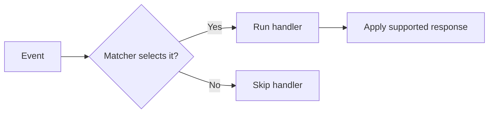
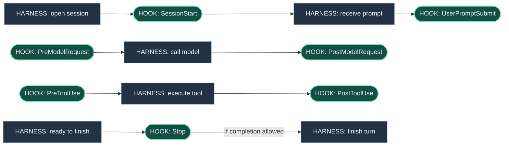
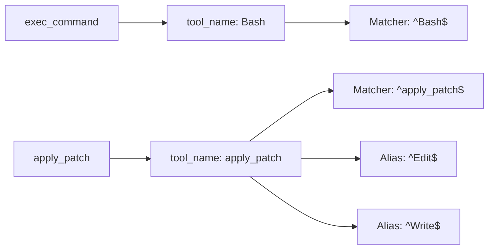
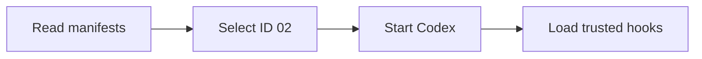

# Codex CLI hooks

<p class="lead">Run code at defined points in the agent lifecycle</p>

Add runtime context · Check tool calls · Observe execution

**Events, matchers, handlers, and response contracts**

<!--
Hooks are runtime callbacks, distinct from instructions that ask the model to remember a workflow. Source: https://learn.chatgpt.com/docs/hooks
-->

---
class: compact
---

# Event, matcher, and handler



- **Event:** selects the lifecycle point
- **Matcher:** filters one event field
- **Handler:** runs code and inspects the payload
- **Response:** provides context, a decision, feedback, or diagnostics

<!--
A hook is a runtime callback. The matcher does not replace script logic; it only determines which event occurrences reach the handler. Source: https://learn.chatgpt.com/docs/hooks#config-shape
-->

---
class: compact
---

# Hook timing versus harness execution

<p class="caption"><strong>HOOK</strong> rounded nodes = callback points · <strong>HARNESS</strong> rectangles = internal work</p>



<p class="caption">HOOK points invoke enabled, matching, trusted handlers. Read rows top to bottom; model/tool rows can repeat.</p>


<!--
The rectangles are internal harness work, not hook names. Rounded nodes show named events where callbacks can be dispatched. The diagram is a simplified normal path: configured synchronous handlers finish before the harness moves on; async handlers do not hold the operation. A hook may change or stop the flow where its contract permits, and there may be no matching handler. UserPromptSubmit is before sending the prompt onward. PreModelRequest and PostModelRequest bracket each request attempt. PreToolUse and PostToolUse bracket supported tool execution. PermissionRequest is conditional and occurs before surfacing a required approval request. Stop is before a main turn completes; SessionEnd is separate from a turn. Compaction, child agents, and interruptions have additional events explained later. Source: https://learn.chatgpt.com/docs/hooks
-->

---
class: compact
---

# Common input fields

Every command hook receives **one JSON object on stdin**.

```json
{
  "session_id": "session-123",
  "hook_event_name": "PreToolUse",
  "cwd": "/project",
  "model": "active-model",
  "transcript_path": null
}
```

**Shared fields above** + **event-specific fields on the next slides**.

<p class="caption">transcript_path can be null. turn_id and permission_mode occur only on some events.</p>

<p class="caption"><a href="https://learn.chatgpt.com/docs/hooks#common-input-fields" target="_blank" rel="noopener noreferrer">Official shared input fields</a></p>

<!--
The object is the common input envelope; an actual tool event also adds tool-specific fields. model is a Codex extension. transcript_path may be null and its file format is not stable. turn_id is listed in turn-scoped event tables, and permission_mode is present on the supported subset, not every event. Event slides show selected extra fields; use their official links for complete types and requirements. Source: https://learn.chatgpt.com/docs/hooks#common-input-fields
-->

---
class: compact
---

# Common output fields

**There is no output object or field required on every hook.**

| Shared response field | Meaning, where supported |
| --- | --- |
| `systemMessage` | Warning in the UI / event stream |
| `continue` | Event-specific flow control |
| `stopReason` | Reason accompanying that flow control |

**Exit 0 with no output:** success; normal flow continues.

**Event-specific outputs** such as `permissionDecision`, `decision`, and `additionalContext` are shown with each event.

<p class="caption">These shared keys are not supported by every event. suppressOutput is parsed but not implemented.</p>

<p class="caption"><a href="https://learn.chatgpt.com/docs/hooks#common-output-fields" target="_blank" rel="noopener noreferrer">Official shared outputs and event restrictions</a></p>

<!--
Do not present common output fields as mandatory or universally supported. SessionStart, PreCompact, PostCompact, UserPromptSubmit, SubagentStop, and Stop support the documented common shape. SubagentStart supports systemMessage and hook context, but continue:false does not prevent starting. PreToolUse and PermissionRequest do not support continue/stopReason. PostToolUse has its own continue:false behavior. Model-request outputs are diagnostic only; SessionEnd is advisory. Plain stdout text is developer context on SessionStart, SubagentStart, and UserPromptSubmit; it is ignored or invalid on other events. Source: https://learn.chatgpt.com/docs/hooks#common-output-fields
-->

---
class: compact
---

# Trust and configuration

- Project hooks: `.codex/hooks.json`
- Review definitions through **`/hooks`**
- User, project, plugin, and managed sources accumulate
- Matching command handlers can run concurrently

**One event → matcher → handler → response**

<!--
Trusted project layer and trusted hook definition are separate requirements. Config sources accumulate, so higher precedence does not remove lower hooks. Managed hooks are trusted by policy. Inline TOML and JSON at one layer merge with a warning. Source: https://learn.chatgpt.com/docs/hooks#review-and-trust-hooks
-->

---
class: compact
---

# What matcher means

**A regular-expression filter applied before the handler runs.**

```json
"PreToolUse": [{
  "matcher": "^Bash$",
  "hooks": [{
    "type": "command",
    "command": "python3 check.py"
  }]
}]
```

Run `check.py` before supported tools named exactly **Bash**.

`^` = beginning · `$` = end · `|` = alternatives

<p class="caption"><a href="https://learn.chatgpt.com/docs/hooks#matcher-patterns" target="_blank" rel="noopener noreferrer">Official contract and behavior</a></p>

<!--
The event chooses when; matcher filters one defined event field; the handler makes a content-based decision. Omit matcher, use an empty string, or the special * value to match every occurrence. Matching still requires an enabled, trusted hook. Source: https://learn.chatgpt.com/docs/hooks#matcher-patterns
-->

---
class: compact
---

# Tool name versus command content

With `PreToolUse` and `"matcher": "^Bash$"`:

| Pending tool call | Handler runs? |
| --- | --- |
| Bash → `git status` | Yes |
| Bash → `git push` | Yes |
| apply_patch → edit a file | No |

To distinguish the two Git commands, inspect **`tool_input.command`** inside the handler.

<p class="caption"><a href="https://learn.chatgpt.com/docs/hooks#matcher-patterns" target="_blank" rel="noopener noreferrer">Official contract and behavior</a></p>

<!--
Matcher does not search shell command text. Both Git operations are tool_name Bash. A git push matcher would not select them. Filename checks also belong in the handler. Source: https://learn.chatgpt.com/docs/hooks#matcher-patterns
-->

---
class: compact
---

# What each event matches

| Event | Matcher filters |
| --- | --- |
| PreToolUse / PostToolUse / PermissionRequest | Tool name and aliases |
| SessionStart | source: startup, resume, clear, compact, fork |
| PreCompact / PostCompact | trigger: manual or auto |
| SubagentStart / SubagentStop | agent_type |
| SessionEnd | reason: currently other |

**Ignored:** UserPromptSubmit, Stop, Interrupt, PreModelRequest, PostModelRequest

<p class="caption"><a href="https://learn.chatgpt.com/docs/hooks#matcher-patterns" target="_blank" rel="noopener noreferrer">Official contract and behavior</a></p>

<!--
Use ^startup$ for a fresh-session source and ^manual$ for manual compaction. Matcher is ignored on the listed events even if supplied. Conditional logic for those belongs in the script. Source: https://learn.chatgpt.com/docs/hooks#matcher-patterns
-->

---
class: compact
---

# Tool names and matching aliases



**An alias is another matching name for the same tool.**

`Edit` and `Write` select the same `apply_patch` call; the input still reports `apply_patch`.

<p class="caption"><a href="https://learn.chatgpt.com/docs/hooks#tool-coverage" target="_blank" rel="noopener noreferrer">Official tool names and aliases</a></p>

<!--
Distinguish the execution API name from the hook-facing tool name: exec_command is reported as Bash. Then explain aliases through one concrete operation: the same apply_patch call can be selected using apply_patch, Edit, or Write; the event payload is not renamed. Edit and Write are aliases here, not a way to distinguish editing from creating files. Inspect the patch content inside the handler for that distinction. For MCP tools, use the canonical MCP tool name; other local tools normally use their function name, with Agent also matching spawn_agent. Hosted tools such as WebSearch do not use this local hook path.
Source: https://learn.chatgpt.com/docs/hooks#matcher-patterns
Source: https://learn.chatgpt.com/docs/hooks#tool-coverage
-->

---
class: compact
---

# How demo.sh starts a scenario

```sh
cd codex-hooks-workshop
./demo.sh 02
```



Codex starts in **02-command-guard/**. Then enter the event slide’s prompt.

<p class="caption">Review project and hook trust when prompted. The launcher starts Codex; Codex triggers the hooks.</p>

<!--
The shell entry point resolves its own directory and delegates to demo.py. It discovers immediate child directories containing manifest.json, validates their declared event names against .codex/hooks.json, and selects the requested ID. For ordinary scenarios it execs codex --no-daemon -C with the absolute scenario path. This is a separate local Codex process; --no-daemon avoids the shared daemon. Scenario 05 declares a read-only sandbox and on-request approval policy in its manifest to make permission requests observable. The script does not itself invoke hook.py, establish hook trust, or submit a prompt. Review the project and hooks through /hooks; restart a startup-context session after review when needed. Each scenario directory contains its own .codex/hooks.json. This launch command is separate from make start, which serves the presentation.
Repository source: codex-hooks-workshop/demo.sh
Hook discovery reference: https://learn.chatgpt.com/docs/hooks#where-codex-looks-for-hooks
-->

---
class: compact
---

# SessionStart: runtime context

**When:** When a session starts, resumes, clears, compacts, or forks.

**Extra input (selected):** source; permission_mode.

**Output:** additionalContext adds developer context.

```json
{"hookSpecificOutput": {
  "hookEventName": "SessionStart",
  "additionalContext": "Selected environment: staging."
}}
```

<p class="caption"><a href="https://learn.chatgpt.com/docs/hooks#sessionstart" target="_blank" rel="noopener noreferrer">Official SessionStart I/O</a></p>

<div class="try-it"><strong>Run <code>./demo.sh 01</code></strong> <span>(from codex-hooks-workshop/)</span><br><strong>Prompt:</strong> In a new session: “Which deployment environment is selected? Answer without using tools.”</div>

<!--
Match source compact to restore context after compaction. Plain text on stdout also becomes developer context.
Examples illustrate the contract rather than a recorded execution. Source: https://learn.chatgpt.com/docs/hooks
-->

---
class: compact
---

# PreToolUse: checking an operation

**When:** Before a supported local tool executes.

**Extra input (selected):** tool_name, tool_input, tool_use_id.

**Output:** permissionDecision: deny; optionally context or rewritten input.

```json
{"hookSpecificOutput": {
  "hookEventName": "PreToolUse",
  "permissionDecision": "deny",
  "permissionDecisionReason": "Production operation blocked."
}}
```

<p class="caption"><a href="https://learn.chatgpt.com/docs/hooks#pretooluse" target="_blank" rel="noopener noreferrer">Official PreToolUse I/O</a></p>

<div class="try-it"><strong>Run <code>./demo.sh 02</code></strong> <span>(from codex-hooks-workshop/)</span><br><strong>Prompt:</strong> Run exactly python3 deploy.py --env production once. If blocked, report the denial and do not retry.<br><span>Then compare with python3 deploy.py --env staging.</span></div>

<!--
For Bash and apply_patch, the inspected command is tool_input.command. Other local tools send their argument object.
Examples illustrate the contract rather than a recorded execution. Source: https://learn.chatgpt.com/docs/hooks
-->

---
class: compact
---

# PostToolUse: observing completion

**When:** After supported tool output, including a failed shell command.

**Extra input (selected):** tool_name, tool_input, tool_response, tool_use_id.

**Output:** additionalContext or decision/reason; the action already ran.

```json
{"hookSpecificOutput": {
  "hookEventName": "PostToolUse",
  "additionalContext": "The command updated generated files."
}}
```

<p class="caption">Example response: adds context after the tool has run.</p>

<p class="caption"><a href="https://learn.chatgpt.com/docs/hooks#posttooluse" target="_blank" rel="noopener noreferrer">Official PostToolUse I/O</a></p>

<div class="try-it"><strong>Run <code>./demo.sh 03</code></strong> <span>(from codex-hooks-workshop/)</span><br><strong>Prompt:</strong> Run exactly python3 hello.py once, then briefly report its output.</div>

<!--
The response example adds context. A handler that only records metadata can instead return {}.
Examples illustrate the contract rather than a recorded execution. Source: https://learn.chatgpt.com/docs/hooks
-->

---
class: compact
---

# UserPromptSubmit: checking a prompt

**When:** Before a user prompt is sent.

**Extra input (selected):** prompt; turn_id and permission_mode.

**Output:** decision/reason rejects; additionalContext adds context.

```json
{
  "decision": "block",
  "reason": "Remove the synthetic secret marker."
}
```

<p class="caption"><a href="https://learn.chatgpt.com/docs/hooks#userpromptsubmit" target="_blank" rel="noopener noreferrer">Official UserPromptSubmit I/O</a></p>

<div class="try-it"><strong>Run <code>./demo.sh 04</code></strong> <span>(from codex-hooks-workshop/)</span><br><strong>Prompt:</strong> Explain DEMO_SECRET_123.<br><span>Then submit a normal prompt to compare.</span></div>

<!--
Matcher is ignored. Plain stdout text can add context. Return decision block or exit 2 with a reason to reject the prompt.
Examples illustrate the contract rather than a recorded execution. Source: https://learn.chatgpt.com/docs/hooks
-->

---
class: compact
---

# PermissionRequest: approval decisions

**When:** Only when Codex is about to request approval.

**Extra input (selected):** tool_name, tool_input; description may be present.

**Output:** decision.behavior: allow / deny; {} keeps normal approval.

```json
{"hookSpecificOutput": {
  "hookEventName": "PermissionRequest",
  "decision": {
    "behavior": "deny",
    "message": "Policy denies this requested write."
  }
}}
```

<p class="caption"><a href="https://learn.chatgpt.com/docs/hooks#permissionrequest" target="_blank" rel="noopener noreferrer">Official PermissionRequest I/O</a></p>

<div class="try-it"><strong>Run <code>./demo.sh 05</code></strong> <span>(from codex-hooks-workshop/)</span><br><strong>Prompt:</strong> Run exactly python3 write_marker.py. If the sandbox rejects it, request elevated approval to rerun it.<br><span>Requires an actual approval request.</span></div>

<!--
Use hookSpecificOutput.decision.behavior. If several matching hooks decide, deny wins; {} leaves the normal approval prompt. This event does not run on already-permitted operations.
Examples illustrate the contract rather than a recorded execution. Source: https://learn.chatgpt.com/docs/hooks
-->

---
class: compact
---

# Stop: checking completion

**When:** When the main turn is about to finish.

**Extra input (selected):** last_assistant_message, stop_hook_active.

**Output:** decision/reason requests continuation; {} allows completion.

```python
if checks_passed:
    print("{}")
elif payload.get("stop_hook_active"):
    print(json.dumps({"systemMessage": "Follow-up limit reached."}))
else:
    print(json.dumps({"decision": "block", "reason": "Run checks."}))
```

<p class="caption"><a href="https://learn.chatgpt.com/docs/hooks#stop" target="_blank" rel="noopener noreferrer">Official Stop I/O</a></p>

<div class="try-it"><strong>Run <code>./demo.sh 06</code></strong> <span>(from codex-hooks-workshop/)</span><br><strong>Prompt:</strong> Reply Ready.<br><span>Start with answer.txt set to 41; the hook requests the follow-up check.</span></div>

<!--
Here decision block creates a continuation prompt using reason. Bound follow-ups with stop_hook_active. continue:false overrides continuation requests. Matcher is ignored.
Examples illustrate the contract rather than a recorded execution. Source: https://learn.chatgpt.com/docs/hooks
-->

---
class: compact
---

# Compaction: saving and restoring context

**When:** PreCompact before compaction; PostCompact after it.

**Extra input (selected):** trigger: manual / auto; turn_id.

**Output:** systemMessage; continue:false stops before / after compaction.

```text
PreCompact                  Save task checkpoint
PostCompact                 Record completed compaction
SessionStart source=compact Restore checkpoint as context
```

<p class="caption"><a href="https://learn.chatgpt.com/docs/hooks#precompact" target="_blank" rel="noopener noreferrer">Official PreCompact I/O</a> · <a href="https://learn.chatgpt.com/docs/hooks#postcompact" target="_blank" rel="noopener noreferrer">Official PostCompact I/O</a> · <a href="https://learn.chatgpt.com/docs/hooks#sessionstart" target="_blank" rel="noopener noreferrer">Official SessionStart I/O</a></p>

<div class="try-it"><strong>Run <code>./demo.sh 07</code></strong> <span>(from codex-hooks-workshop/)</span><br><strong>Prompt:</strong> Explain how you would investigate a failing test.<br><span>Then run /compact to trigger PreCompact, PostCompact, and startup-context restoration.</span></div>

<!--
PreCompact continue:false stops before compaction; PostCompact continue:false stops after. SessionStart source compact is the supported point for adding restored developer context. A checkpoint must be created by your own logic.
Examples illustrate the contract rather than a recorded execution. Source: https://learn.chatgpt.com/docs/hooks
-->

---
class: compact
---

# SubagentStart and SubagentStop

**When:** When a child agent starts or is about to finish.

**Extra input (selected):** agent_id, agent_type; stop adds last_assistant_message, stop_hook_active.

**Output:** Start: additionalContext. Stop: decision/reason for follow-up.

```text
SubagentStart → additionalContext → reviewer instructions
SubagentStop  → decision: block   → request a verification note
              → {}               → report complete
```

<p class="caption"><a href="https://learn.chatgpt.com/docs/hooks#subagentstart" target="_blank" rel="noopener noreferrer">Official SubagentStart I/O</a> · <a href="https://learn.chatgpt.com/docs/hooks#subagentstop" target="_blank" rel="noopener noreferrer">Official SubagentStop I/O</a></p>

<div class="try-it"><strong>Run <code>./demo.sh 08</code></strong> <span>(from codex-hooks-workshop/)</span><br><strong>Prompt:</strong> Use one read-only subagent to inspect README.md and report a short summary with a Tests: line. Wait for it to finish.</div>

<!--
Matcher filters agent_type. SubagentStart continue:false does not prevent child startup. SubagentStop uses stop_hook_active for bounded continuation; continue:false overrides continuation decisions. Session ID refers to the parent.
Examples illustrate the contract rather than a recorded execution. Source: https://learn.chatgpt.com/docs/hooks
-->

---
class: compact
---

# PreModelRequest and PostModelRequest

**When:** Before and after each model request attempt, including retries.

**Extra input (selected):** turn_id; optional agent identifiers. Post adds status, error, token_usage.

**Output:** Diagnostics only; cannot block or add model context.

```json
{
  "status": "completed",
  "error": null,
  "token_usage": null
}
```

<p class="caption">Input excerpt; handler output remains diagnostic only.</p>

<p class="caption"><a href="https://learn.chatgpt.com/docs/hooks#premodelrequest-and-postmodelrequest" target="_blank" rel="noopener noreferrer">Official PreModelRequest I/O</a> · <a href="https://learn.chatgpt.com/docs/hooks#premodelrequest-and-postmodelrequest" target="_blank" rel="noopener noreferrer">Official PostModelRequest I/O</a></p>

<div class="try-it"><strong>Run <code>./demo.sh 09</code></strong> <span>(from codex-hooks-workshop/)</span><br><strong>Prompt:</strong> Reply with one sentence describing a hook.<br><span>Both request events fire for the model attempt.</span></div>

<!--
status is completed, failed, or cancelled; token_usage can be null. agent_id and agent_type may also be present. A single user turn can contain several requests. The displayed object is an input excerpt; diagnostic handlers do not control the model request.
Examples illustrate the contract rather than a recorded execution. Source: https://learn.chatgpt.com/docs/hooks
-->

---
class: compact
---

# Interrupt: recording interruption

**When:** An active main-thread turn is interrupted.

**Extra input (selected):** turn_id and permission_mode.

**Output:** Optional systemMessage; cannot prevent interruption or restart.

```json
{
  "systemMessage": "Recorded interruption locally."
}
```

<p class="caption"><a href="https://learn.chatgpt.com/docs/hooks#interrupt" target="_blank" rel="noopener noreferrer">Official Interrupt I/O</a></p>

<div class="try-it"><strong>Run <code>./demo.sh 10</code></strong> <span>(from codex-hooks-workshop/)</span><br><strong>Prompt:</strong> Run python3 slow.py and wait for it to finish.<br><span>Press Esc while the turn is active.</span></div>

<!--
No event for idle threads or subagents. Output may contain systemMessage or be empty. Timeout is one to three seconds. Interruption does not guarantee rollback of tool effects.
Examples illustrate the contract rather than a recorded execution. Source: https://learn.chatgpt.com/docs/hooks
-->

---
class: compact
---

# SessionEnd: closing a session

**When:** The main session actually ends.

**Extra input (selected):** reason: currently other.

**Output:** Advisory bookkeeping only; no model steering.

```json
{
  "reason": "other"
}
```

<p class="caption">Input excerpt; a bookkeeping handler can return {}.</p>

<p class="caption"><a href="https://learn.chatgpt.com/docs/hooks#sessionend" target="_blank" rel="noopener noreferrer">Official SessionEnd I/O</a></p>

<div class="try-it"><strong>Run <code>./demo.sh 11</code></strong> <span>(from codex-hooks-workshop/)</span><br><strong>Prompt:</strong> Reply with one sentence describing a hook.<br><span>After the reply, exit normally with /quit.</span></div>

<!--
Changing chats is not immediate session end. Always synchronous even with async:true. No MCP tool handlers. Default timeout one second, maximum three. The displayed object is an input excerpt.
Examples illustrate the contract rather than a recorded execution. Source: https://learn.chatgpt.com/docs/hooks
-->

---
class: compact
---

# PreToolUse: rewriting input

**When:** Before a supported call executes.

**Extra input (selected):** tool_input: original arguments.

**Output:** permissionDecision: allow plus updatedInput.

```json
{"hookSpecificOutput": {
  "hookEventName": "PreToolUse",
  "permissionDecision": "allow",
  "updatedInput": {
    "command": "python3 greet.py --name workshop"
  }
}}
```

<p class="caption"><a href="https://learn.chatgpt.com/docs/hooks#pretooluse" target="_blank" rel="noopener noreferrer">Official PreToolUse I/O</a></p>

<div class="try-it"><strong>Run <code>./demo.sh 12</code></strong> <span>(from codex-hooks-workshop/)</span><br><strong>Prompt:</strong> Run exactly python3 greet.py once.</div>

<!--
Bash and apply_patch require a string command in updatedInput. Other tools use their own argument shape. Preserve other relevant fields such as timeouts.
Examples illustrate the contract rather than a recorded execution. Source: https://learn.chatgpt.com/docs/hooks
-->

---
class: compact
---

# PostToolUse: replacing feedback

**When:** After a tool has already produced effects and output.

**Extra input (selected):** tool_input and tool_response.

**Output:** decision: block plus reason replaces feedback after execution.

```json
{
  "decision": "block",
  "reason": "Generator already ran. Report that review is needed."
}
```

<p class="caption"><a href="https://learn.chatgpt.com/docs/hooks#posttooluse" target="_blank" rel="noopener noreferrer">Official PostToolUse I/O</a></p>

<div class="try-it"><strong>Run <code>./demo.sh 13</code></strong> <span>(from codex-hooks-workshop/)</span><br><strong>Prompt:</strong> Run exactly python3 generate.py once, then report the outcome without rerunning it.</div>

<!--
decision:block or exit 2 cannot undo side effects. In code mode, they reject the nested tool promise; continue:false replaces model-facing feedback without that rejection.
Examples illustrate the contract rather than a recorded execution. Source: https://learn.chatgpt.com/docs/hooks
-->

---
class: compact
---

# Background command hooks

**When:** Alongside the operation that triggered the event.

**Extra input (selected):** Same event payload; async is a handler setting.

**Output:** Informational context / warning only; no control decisions.

```json
{
  "type": "command",
  "command": "python3 .../hook.py",
  "async": true,
  "timeout": 5
}
```

<p class="caption"><a href="https://learn.chatgpt.com/docs/hooks#posttooluse" target="_blank" rel="noopener noreferrer">Official PostToolUse I/O</a></p>

<div class="try-it"><strong>Run <code>./demo.sh 14</code></strong> <span>(from codex-hooks-workshop/)</span><br><strong>Prompt:</strong> Run exactly python3 hello.py and briefly explain its result.<br><span>Keep the session open so the delayed hook can finish.</span></div>

<!--
Background hooks cannot deny, approve, rewrite, or request continuation. Output while idle waits for the next user turn. Session end cancels unfinished handlers. SessionEnd itself remains synchronous.
Examples illustrate the contract rather than a recorded execution. Source: https://learn.chatgpt.com/docs/hooks
-->

---
class: compact
---

# PreToolUse: matching file edits

**When:** Before apply_patch executes.

**Extra input (selected):** tool_name: apply_patch; tool_input.command: patch.

**Output:** permissionDecision: deny prevents the supported patch call.

```json
{
  "matcher": "^apply_patch$",
  "hooks": [{
    "type": "command",
    "command": "python3 .../hook.py"
  }]
}
```

<p class="caption"><a href="https://learn.chatgpt.com/docs/hooks#pretooluse" target="_blank" rel="noopener noreferrer">Official PreToolUse I/O</a></p>

<div class="try-it"><strong>Run <code>./demo.sh 15</code></strong> <span>(from codex-hooks-workshop/)</span><br><strong>Prompt:</strong> Use apply_patch to change protected.txt to Changed. If blocked, report the denial and do not try another tool.</div>

<!--
apply_patch matches its canonical name and Edit/Write aliases. Matcher selects the tool, not the path being edited. The handler must inspect patch content. Other write mechanisms are outside this specific match.
Examples illustrate the contract rather than a recorded execution. Source: https://learn.chatgpt.com/docs/hooks
-->

---
class: compact
---

# MCP tool handlers

**When:** A matching lifecycle event calls an already-connected server.

**Extra input (selected):** Arguments expanded from the matching event.

**Output:** The matching event’s response contract applies.

```json
{
  "type": "mcp_tool",
  "server": "workshop_checker",
  "tool": "check_command",
  "input": { "command": "${tool_input.command}" },
  "timeout": 5
}
```

<p class="caption"><a href="https://learn.chatgpt.com/docs/hooks#pretooluse" target="_blank" rel="noopener noreferrer">Official PreToolUse I/O</a></p>

<div class="try-it"><strong>Run <code>./demo.sh 16</code></strong> <span>(from codex-hooks-workshop/)</span><br><strong>Prompt:</strong> Run exactly python3 deploy.py --env production once. If blocked, report the denial and do not retry.<br><span>The MCP server must already be connected.</span></div>

<!--
MCP callbacks are synchronous, require an existing connection, do not ask normal tool approval, and do not trigger other hooks. Missing servers, errors, and timeout do not block. SessionEnd is unsupported.
Examples illustrate the contract rather than a recorded execution. Source: https://learn.chatgpt.com/docs/hooks
-->

---
class: compact
---

# PreToolUse: denial versus failure

**When:** Before a supported call; response handling depends on the result.

**Extra input (selected):** Normal PreToolUse event fields.

**Output:** Exit 2 denies; errors / unsupported fields are not reliable denials.

```text
deny-exit    Exit 2 with a reason on stderr
error        Exit 1: hook failure
invalid-json Invalid JSON output
unsupported  PreToolUse continue:false
timeout     Seven-second script, five-second handler timeout
```

<p class="caption"><a href="https://learn.chatgpt.com/docs/hooks#pretooluse" target="_blank" rel="noopener noreferrer">Official PreToolUse I/O</a></p>

<div class="try-it"><strong>Run <code>./demo.sh 17</code></strong> <span>(from codex-hooks-workshop/)</span><br><strong>Prompt:</strong> Run exactly python3 hello.py once.<br><span>Repeat with mode.txt set to pass, deny-exit, error, invalid-json, unsupported, or timeout.</span></div>

<!--
A timeout, nonzero error, malformed JSON, or unsupported field is not a universal denial mechanism. PreToolUse continue:false is unsupported and can fail without stopping execution.
Examples illustrate the contract rather than a recorded execution. Source: https://learn.chatgpt.com/docs/hooks
-->

---
class: compact
---

# Context size and output spilling

**When:** When a handler returns additionalContext.

**Extra input (selected):** SessionStart source; limit is a handler setting.

**Output:** additionalContext; oversized text becomes a preview / file reference.

```json
{
  "type": "command",
  "command": "python3 .../hook.py",
  "additionalContextLimit": 64,
  "timeout": 5
}
```

<p class="caption"><a href="https://learn.chatgpt.com/docs/hooks#sessionstart" target="_blank" rel="noopener noreferrer">Official SessionStart I/O</a></p>

<div class="try-it"><strong>Run <code>./demo.sh 18</code></strong> <span>(from codex-hooks-workshop/)</span><br><strong>Prompt:</strong> Read the startup reference preview and state its topic briefly without tools.<br><span>Use a new session so SessionStart fires.</span></div>

<!--
The threshold is approximate tokens, not bytes. Default about 2500 tokens; zero disables spilling and needs a strict output cap. Tool feedback and continuation prompts keep the default limit. Never emit sensitive context.
Examples illustrate the contract rather than a recorded execution. Source: https://learn.chatgpt.com/docs/hooks
-->

---
class: compact
---

# Control outputs are event-specific

| Event | “Block” means |
| --- | --- |
| UserPromptSubmit | Reject the prompt |
| PreToolUse | Prevent the supported tool call |
| PostToolUse | Replace feedback after execution |
| Stop | Create a continuation turn |
| SubagentStop | Continue the child flow |

**PermissionRequest** uses `decision.behavior`, not permissionDecision.

<!--
Explain how this behavior changes the agent lifecycle. Source: https://learn.chatgpt.com/docs/hooks
-->

---
class: compact
---

# Background and concurrent handlers

- Matching synchronous commands also launch concurrently
- Background handlers deliver information at a safe point
- Background hooks cannot control the triggering operation
- Up to eight background hooks run per session
- Session end cancels unfinished background work

**SessionEnd itself remains synchronous.**

<!--
Explain how this behavior changes the agent lifecycle. Source: https://learn.chatgpt.com/docs/hooks
-->

---
class: compact
---

# Handler and configuration choices

| Choice | Use |
| --- | --- |
| command | Local script receiving event JSON |
| mcp_tool | Callback on an existing connection |
| JSON or inline TOML | Equivalent config representations |
| Plugin hooks | Bundle scripts and configuration |

**prompt / agent handlers are parsed but skipped.**

<!--
Plugin hooks can use PLUGIN_ROOT and writable PLUGIN_DATA, with compatibility aliases. Managed and cloud-orchestrated hooks have different deployment rules; these concepts concern local CLI hooks. prompt and agent handlers are parsed but skipped. Source: https://learn.chatgpt.com/docs/hooks
-->

---
class: compact
---

# Defaults and boundaries

- Keep context concise; the default spill threshold is about 2,500 tokens
- Use explicit short timeouts for handler scripts
- Interrupt permits 1–3 seconds; SessionEnd has a short budget
- Treat malformed output as a failure, not an explicit policy decision
- Avoid parsing transcript files as a stable API

**Read the contract for the exact event and CLI release.**

<!--
Most command hooks have a long default timeout. Interrupt and SessionEnd default to one second and allow at most three. additionalContextLimit zero disables spilling and needs a bounded output strategy. Unsupported-field failure behavior differs by event. Source: https://learn.chatgpt.com/docs/hooks
-->

---
class: compact
---

# Choosing what to automate

| Need | Starting point |
| --- | --- |
| Persistent conventions | AGENTS.md |
| Runtime context | SessionStart / UserPromptSubmit |
| Tool checks | PreToolUse / PermissionRequest |
| Visibility | PostToolUse / model request hooks |
| Verification | Stop / SubagentStop |
| Bookkeeping | Compaction / Interrupt / SessionEnd |

<!--
Explain how this behavior changes the agent lifecycle. Source: https://learn.chatgpt.com/docs/hooks
-->

---
class: compact
---

# Official hook reference

[Every event and its input/output contract](https://learn.chatgpt.com/docs/hooks#hooks)

[Matcher rules](https://learn.chatgpt.com/docs/hooks#matcher-patterns) · [Tool coverage](https://learn.chatgpt.com/docs/hooks#tool-coverage)

[Common inputs](https://learn.chatgpt.com/docs/hooks#common-input-fields) · [Common outputs](https://learn.chatgpt.com/docs/hooks#common-output-fields)

[Trust review](https://learn.chatgpt.com/docs/hooks#review-and-trust-hooks) · [MCP handlers](https://learn.chatgpt.com/docs/hooks#mcp-tool-hooks)

<p class="caption">Local Codex CLI behavior · Reference checked 5 November 2026</p>

<!--
Use the official release-behavior guide. Main-branch generated schemas can contain behavior not yet released.
-->
